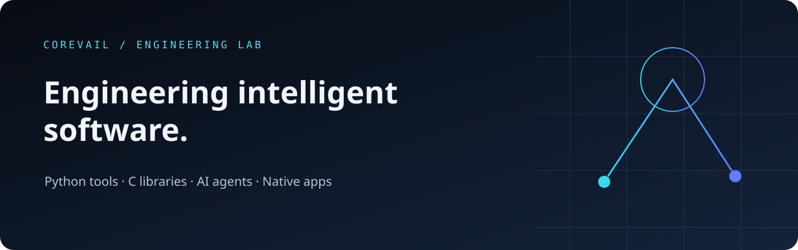
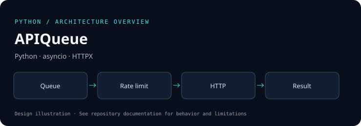
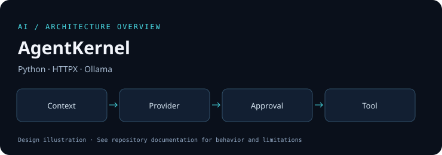
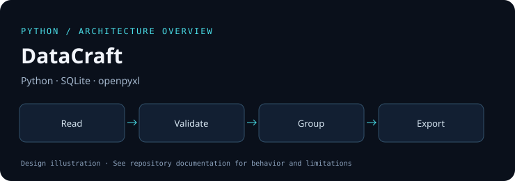

<a href="https://corevail.github.io/portfolio/">Portfolio</a> · <a href="https://github.com/corevail?tab=repositories">Repositories</a> · <a href="https://github.com/corevail?tab=overview">GitHub activity</a>

## Introduction

I build practical developer tools, C libraries, AI agent components and native macOS software. This collection focuses on clear contracts, observable failures and reproducible checks. The projects began as original, AI-assisted portfolio work; the code and verification details are available to inspect.

## Tech stack

| Area | Technologies used in this collection |
|---|---|
| Languages | Python · C11 · Swift · JavaScript |
| AI | Ollama adapters · OpenAI-compatible HTTP APIs · explicit tool approval |
| Backend & APIs | HTTPX · asyncio · REST clients |
| Data | SQLite · CSV / JSON / JSONL · openpyxl |
| Desktop | SwiftUI · SwiftPM · macOS system APIs |
| Infrastructure | GitHub Actions · CMake · pytest · Ruff · ASan / UBSan |
| Web | Semantic HTML · CSS · JavaScript · GitHub Pages |

## Featured projects

Architecture graphics below are illustrations; application screenshots and executable examples are in the repositories.

<table>
<tr>
<td width="50%" valign="top"><h3><a href="https://github.com/corevail/fileforge">FileForge</a></h3>
File inventories, SHA-256 duplicate detection and planned renames with collision checks.

<code>Python · pathlib · CLI</code>
</td>
<td width="50%" valign="top"><h3><a href="https://github.com/corevail/apiqueue">APIQueue</a></h3>
Bounded asynchronous HTTP jobs with retries, rate limits and structured results.

<code>Python · asyncio · HTTPX</code>
</td>
</tr>
<tr>
<td width="50%" valign="top"><h3><a href="https://github.com/corevail/agentkernel">AgentKernel</a></h3>
A compact agent runtime with tools, provider adapters, request budgets and explicit approval.

<code>Python · HTTPX · Ollama</code>
</td>
<td width="50%" valign="top"><h3><a href="https://github.com/corevail/corearena">CoreArena</a></h3>
C11 arena and pool allocators with checked arithmetic, allocation statistics and sanitizers.

<code>C11 · CMake · ASan / UBSan</code>
</td>
</tr>
<tr>
<td width="50%" valign="top"><h3><a href="https://github.com/corevail/devscope">DevScope</a></h3>
A macOS SwiftUI control center for system metrics, tasks, approved scripts and logs.

<code>Swift · SwiftUI · macOS</code>
</td>
<td width="50%" valign="top"><h3><a href="https://github.com/corevail/datacraft">DataCraft</a></h3>
Validated CSV, JSONL, JSON and XLSX pipelines with disk-backed grouping and exact decimal sums.

<code>Python · SQLite · openpyxl</code>
</td>
</tr>
</table>

## What I build

- **Automation:** file inventories, planned renames and bounded HTTP workloads.
- **Systems components:** checked allocation, predictable lifetimes and sanitizer-tested C.
- **AI tooling:** provider adapters, request budgets and human approval for sensitive tools.
- **Native software:** macOS monitoring, task state and approved script execution.
- **Data pipelines:** validated formats, disk-backed grouping and atomic results.

## Open source

Alongside the original projects, two attributed forks contain specific source improvements and regression tests:

- [schedule-safe-intervals](https://github.com/corevail/schedule-safe-intervals): reject invalid recurring intervals that can otherwise hang scheduling.
- [humanize-numeric-edges](https://github.com/corevail/humanize-numeric-edges): consistent nonfinite file-size formatting.

Their original licenses and histories are preserved. These are maintained changes in forks; upstream acceptance is not claimed.

## GitHub activity

[Explore the native GitHub activity view](https://github.com/corevail?tab=overview) and each repository's Actions tab for current checks. The profile uses local assets and native GitHub links, so it does not depend on an external statistics image service.

## Development philosophy

Keep components small, bound resource use, preserve data on failure and test error paths. Document the difference between implemented behavior, local verification and future work. AI provider adapters are covered offline; real model execution requires its own integration check.

## Contact

[GitHub profile](https://github.com/corevail) · [Portfolio](https://corevail.github.io/portfolio/)

For concrete feedback or a reproducible defect, open an issue in the relevant repository.
